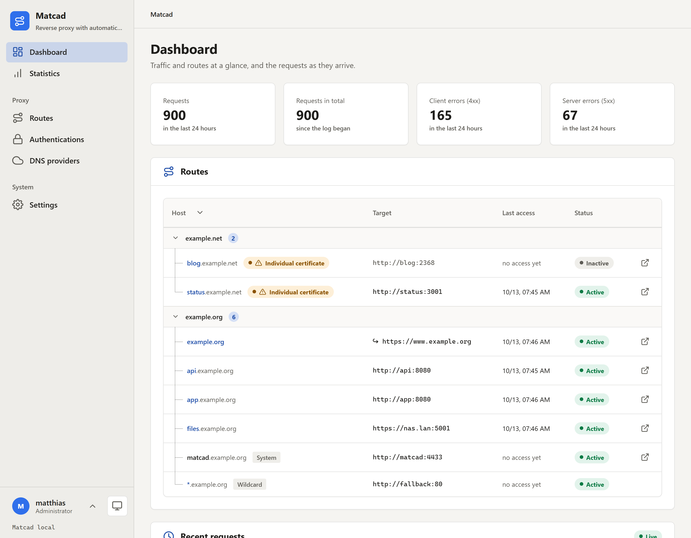
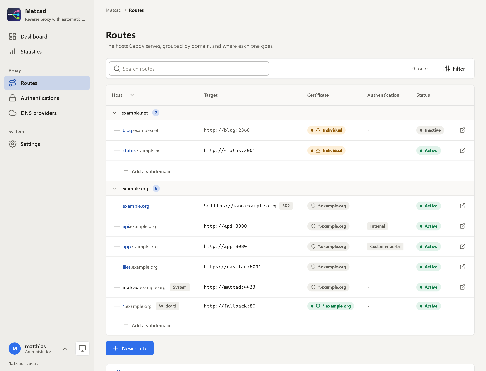
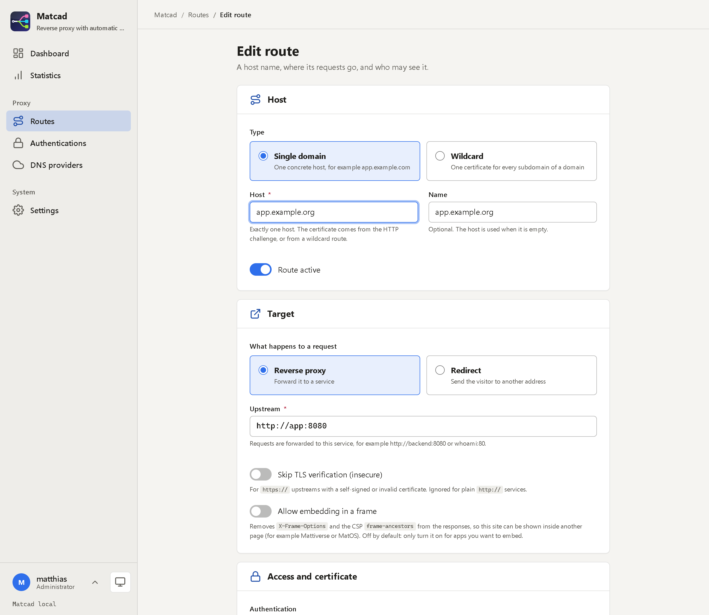
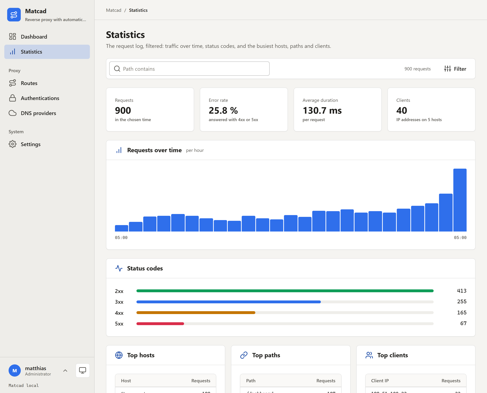
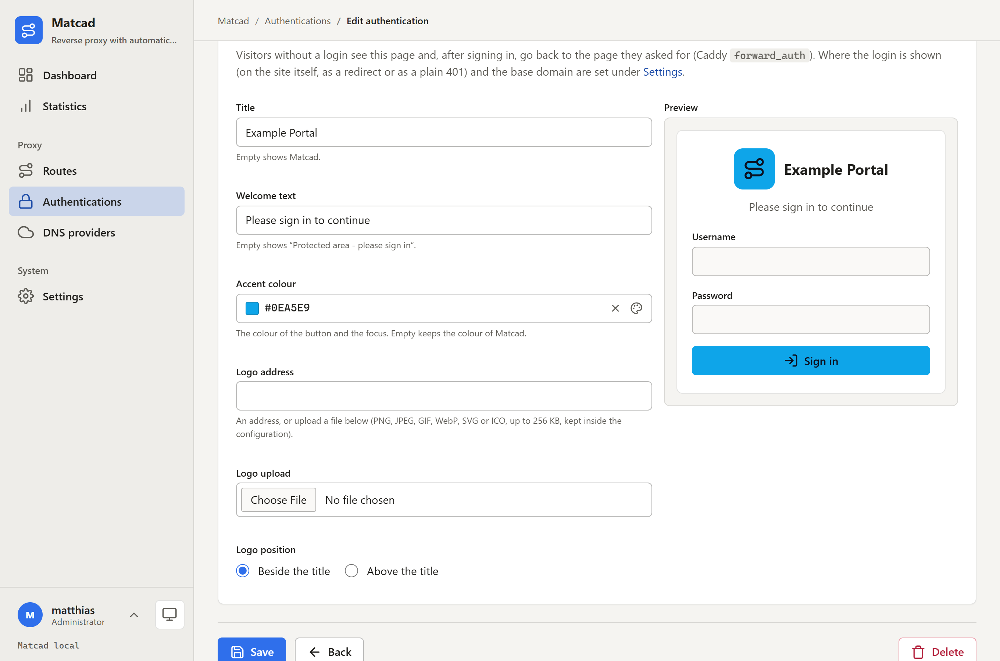
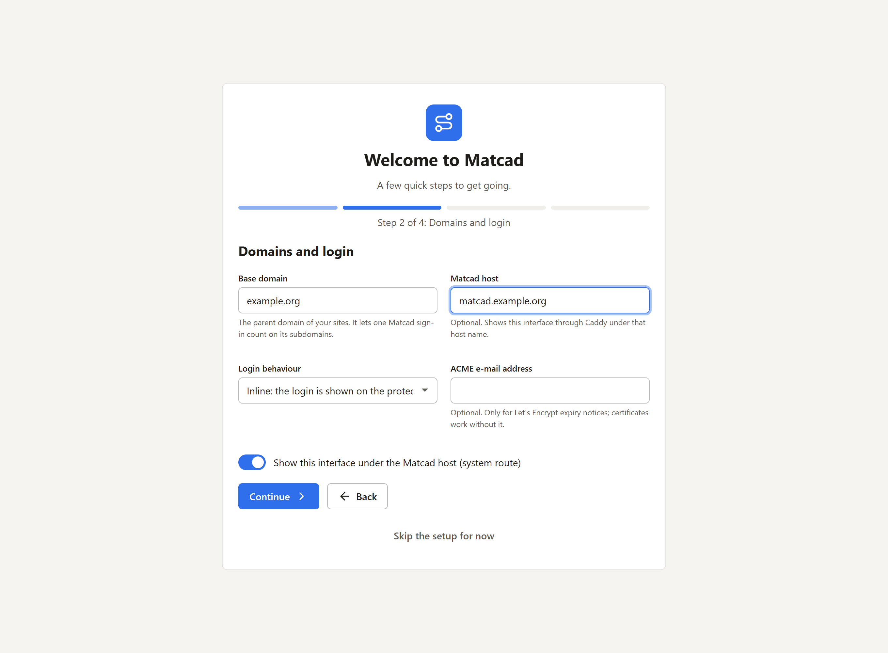
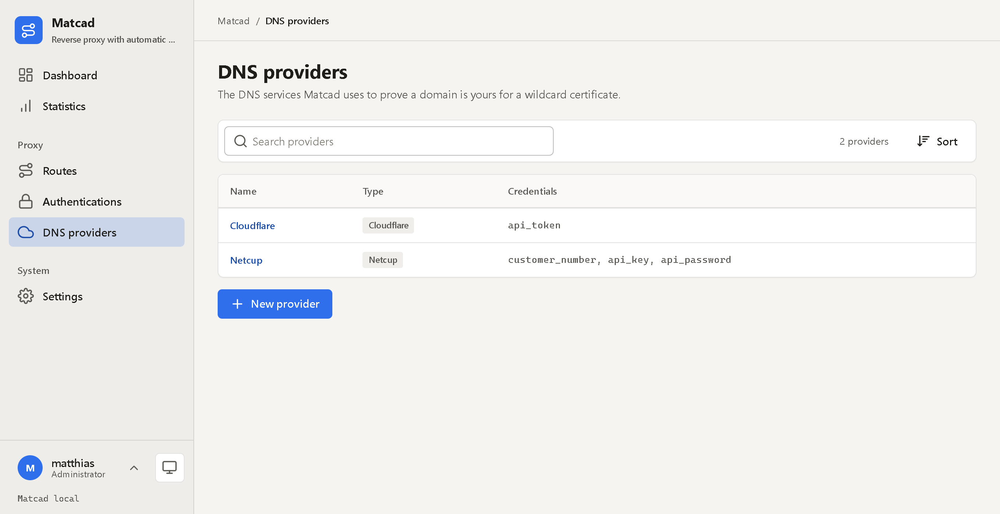

<div align="center">


# Matcad

**A web UI for the Caddy reverse proxy.**

Routes, wildcard HTTPS via DNS providers, a built-in login portal, request
statistics, Docker discovery and Caddyfile import. Two containers, no cloud,
no config files to hand-edit.

</div>



---

## What this is about

Caddy is a fantastic reverse proxy with automatic HTTPS, but running it usually
means editing a Caddyfile by hand and juggling DNS credentials, wildcard
certificates and per-site authentication. Matcad puts a UI on top of Caddy and
drives it through its JSON admin API: you click a route together, pick "reverse
proxy" or "redirect", protect it with a login if you want, and Matcad pushes the
whole config to Caddy. You keep Caddy's rock-solid proxying and auto-HTTPS, and
lose the YAML-in-your-head part.

## At a glance

**Routes**
- A **hierarchical domain tree** built automatically from your host names
- Each route is a **reverse proxy** or a **301/302 redirect** (to any URL, or pick
  an existing domain from a list)
- **Skip TLS verification** per route for HTTPS backends with self-signed certs
- Add a subdomain to an existing domain with one click

**Certificates (automatic HTTPS)**
- **Wildcard certificates** via the ACME DNS-01 challenge
- One `*.domain` certificate also covers the apex and every subdomain, so those
  routes need no provider of their own; the UI shows exactly what each cert covers
- A clear **warning** when a host would get its own individual certificate
- **Propagation delay / timeout** tuning for slow DNS providers (e.g. netcup)

**Authentication**
- **Basic Auth** (browser dialog), managed user list with bcrypt hashes
- A **Matcad login portal** (Caddy `forward_auth`) with its own users and
  **per-domain branding** (title, colour, logo, welcome text, logo position)
- Choose how unauthenticated visitors see it: **inline** on the site, a **redirect**
  to a login host, or a plain **401**

**Insight**
- A **live dashboard** with the route tree, last access and a real-time request log
- **Statistics** with filters (time range, host, status class, method, path) and
  charts for traffic over time, status codes and **top hosts, paths and client IPs**

**Getting your config in**
- **Caddyfile import**: paste a Caddyfile, preview what maps to routes / providers /
  auth, and keep anything unmappable as raw passthrough
- **Docker discovery**: turn running containers into routes via labels
- **Backup / restore** in Matcad's own format, plus a raw Caddy-JSON escape hatch

**DNS providers**
- netcup, Cloudflare, DigitalOcean, Hetzner, Route53, Gandi, deSEC and OVH baked in,
  plus a **Custom** type for any compiled-in `caddy-dns` module
- A **Test credentials** button that checks the provider's API before you rely on it

## Screenshots

### Routes and the certificate picture



Routes are grouped by domain. Each one shows its target and, at a glance, whether
its certificate is a wildcard, covered by one, individual, or Caddy-internal.

### Creating a route



Single host or wildcard, reverse proxy or redirect. Pick "Wildcard" and the host
becomes `*.your-domain`; enter a bare domain that no wildcard covers and Matcad
warns you it would get its own certificate.

### Statistics



Filter by time range, host, status class, method or path, then read traffic over
time, the status-code split and the top hosts, paths and client IPs.

### The login portal, branded per authentication



A Matcad authentication shows a real login page you brand per domain: title,
accent colour, logo, welcome text and logo placement, with a live preview.

### First-run setup

| Setup wizard | Providers |
|---|---|
|  |  |

A fresh install starts empty and walks you through account, domains, an optional
DNS provider and done. You can skip it and set things up later.

## Quick start

Ready-made images are published to the GitHub Container Registry, multi-arch
(`linux/amd64` and `linux/arm64`), so they run on x86 servers and on ARM
(Raspberry Pi, ARM VPS) alike.

| Image | Built from | Use it for |
|---|---|---|
| `ghcr.io/real-ttx/matcad:latest` | version tags on `main` | releases |
| `ghcr.io/real-ttx/matcad-caddy:latest` | version tags on `main` | the bundled Caddy |

### Just run it

Copy this into `docker-compose.yml` and start it - nothing else needed:

```yaml
name: matcad

services:
  caddy:
    image: ghcr.io/real-ttx/matcad-caddy:latest
    restart: unless-stopped
    ports:
      - "80:80"
      - "443:443"
      - "443:443/udp"
    volumes:
      - caddy-data:/data
      - caddy-logs:/caddy-logs

  matcad:
    image: ghcr.io/real-ttx/matcad:latest
    restart: unless-stopped
    depends_on:
      - caddy
    ports:
      - "4433:4433"
    volumes:
      - matcad-data:/data
      - caddy-logs:/caddy-logs

volumes:
  matcad-data:
  caddy-data:
  caddy-logs:
```

```bash
docker compose up -d
```

Caddy serves ports **80/443**; the Matcad UI is on **4433**. Open
**http://localhost:4433** and sign in with **`admin` / `admin`** - the setup
wizard makes you change that right away. Updating is just
`docker compose pull && docker compose up -d`.

> Keep the UI (port 4433) off the public internet - put it behind Caddy with a
> Matcad login, or on your VPN.

### DNS providers and wildcard certificates

For a `*.domain` wildcard certificate, add a DNS provider under *Providers*
(there is a **Test credentials** button), then create a wildcard route and point
it at that provider. Single hosts use Caddy's HTTP challenge and need no provider.
The bundled Caddy ships these `caddy-dns` modules: netcup, cloudflare,
digitalocean, hetzner, route53, gandi, desec, ovh. To use others, build the
images yourself (see below) with an extended `CADDY_DNS_MODULES`.

### Optional: Docker discovery

To turn running containers into routes via labels
(`matcad.enable=true`, `matcad.host`, `matcad.port`, `matcad.auth`), mount the
Docker socket read-only into the `matcad` service:

```yaml
    volumes:
      - matcad-data:/data
      - caddy-logs:/caddy-logs
      - /var/run/docker.sock:/var/run/docker.sock:ro
```

## Ports and volumes

| | |
|---|---|
| `80`, `443`, `443/udp` | Caddy - HTTP, HTTPS, HTTP/3 |
| `4433` | Matcad UI |
| `matcad-data` -> `/data` | SQLite database, JSON config, DataProtection keys |
| `caddy-data` -> `/data` | TLS certificates |
| `caddy-logs` (shared) | access logs Caddy writes and Matcad reads |

The images carry sensible defaults, so no environment variables are required.
Everything else is configured in the UI under *Settings* and stored on the data
volume; an update keeps all of it.

## The `/data` volume

```
/data
├─ matcad.db        SQLite database (users, sessions, request logs)
├─ config/          JSON configuration (providers, routes, authentications, settings)
└─ keys/            DataProtection keys (sessions and portal cookies survive restarts)
```

## How it is built

- **matcad**: ASP.NET Core 10 (Razor Pages), UI on port 4433. Configuration is
  stored as **JSON**, its own state (users, sessions, request logs) in **SQLite** -
  both on the data volume.
- **caddy**: a custom build (via `xcaddy`) with the DNS modules compiled in. Matcad
  generates the full Caddy JSON config and pushes it through the **admin API** on
  every change and at startup, so Caddy always reflects the UI.
- Caddy writes JSON access logs to a shared volume; Matcad tails them into SQLite
  and streams new entries to the dashboard over **Server-Sent Events**.
- The interface is server-rendered with a little plain JavaScript - **no build step**.
- Images are **multi-arch** (`linux/amd64` + `linux/arm64`), cross-compiled so both
  build without emulation.

## Development

```bash
# dev stack: local build, a whoami test upstream, Caddy admin on :2019
./scripts/deploy.ps1
```

- UI: <http://localhost:4433>
- Caddy admin (dev only): <http://localhost:2019/config/>

The set of DNS modules compiled into both images lives once in `.env`
(`CADDY_DNS_MODULES`); add more from <https://github.com/caddy-dns> and rebuild.

## Branches and versioning

| Branch | Purpose |
|---|---|
| `main` | Release - a version tag (`v0.5.0`) builds and publishes the images to GHCR |
| `dev` | Development |

`Major`/`Minor`/`build` live in [`version.json`](version.json). Publishing to GHCR
happens on a version tag via GitHub Actions.
