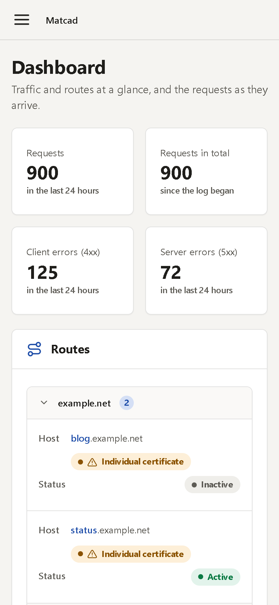
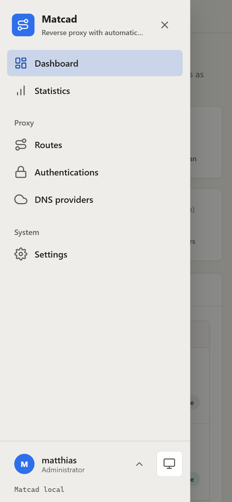
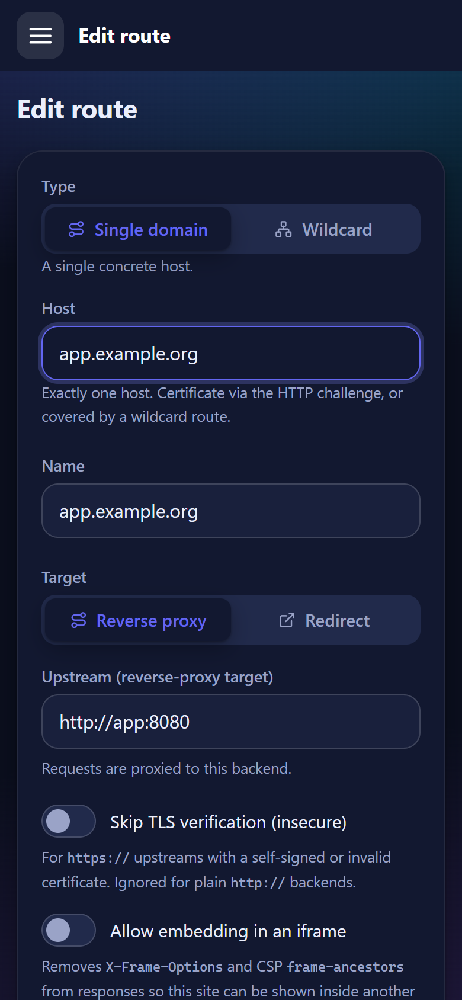

<div align="center">


# Matcad

**A web UI for the Caddy reverse proxy.**

Routes, wildcard HTTPS via DNS providers, a built-in login portal, request
statistics, Docker discovery and Caddyfile import. Two containers, no cloud,
no config files to hand-edit. Installable as an app on your phone and desktop.

</div>


---

## What this is about

Caddy is a fantastic reverse proxy with automatic HTTPS, but running it usually
means editing a Caddyfile by hand and juggling DNS credentials, wildcard
certificates and per-site authentication. Matcad puts a UI on top of Caddy and
drives it through its JSON admin API: you click a route together, pick "reverse
proxy" or "redirect", protect it with a login if you want, and Matcad pushes the
whole config to Caddy. You keep Caddy's rock-solid proxying and auto-HTTPS, and
lose the YAML-in-your-head part.

## At a glance

**Routes**
- A **hierarchical domain tree** built automatically from your host names; every domain folds away, and *Add a subdomain* is the last entry of its group
- Each route is a **reverse proxy** or a **301/302 redirect** (to any URL, or pick
  an existing domain from a list; optionally keeping the path and query)
- Per route: **block common exploits** (SQL injection or script in the query, `/.git`, `/.env`, ...),
  **HSTS**, **compression** (zstd/gzip) and **blocked IP addresses** (set on the route page; the REST API keeps them)
- **Skip TLS verification** per route for HTTPS backends with self-signed certs
- Add a subdomain to an existing domain with one click
- **Guards and upstream headers** (optional, under *Guards and upstream* in the route editor): refuse every request that lacks a
  secret header or does not come from an allowed IP address, send another `Host` header (and TLS server name) to the upstream and set
  your own headers on the request to it - the building blocks for a chain of two proxies, see below

**Certificates (automatic HTTPS)**
- **Wildcard certificates** via the ACME DNS-01 challenge
- One `*.domain` certificate also covers the apex and every subdomain, so those
  routes need no provider of their own; the UI shows exactly what each cert covers
- A clear **warning** when a host would get its own individual certificate
- **Propagation delay / timeout** tuning for slow DNS providers (e.g. netcup)
- A **Certificates** page: every certificate with what it covers, its expiry and the state of the last
  TLS check (every six hours, or *Check now*)

**Authentication**
- **Basic Auth** (browser dialog), managed user list with bcrypt hashes
- **Accounts** sign in with a username or an e-mail address; administrators manage
  everything, users work with routes and authentications (not settings, users or
  DNS provider credentials)
- A **Matcad login portal** (Caddy `forward_auth`) with its own users and
  **per-domain branding** (title, colour, logo, welcome text, logo position)
- Choose how unauthenticated visitors see it: **inline** on the site, a **redirect**
  to a login host, or a plain **401**

**On your phone**
- **Installable app (PWA)** with the Matcad icon, safe-area and notch handling for iOS and
  Android, and no accidental zooming
- When the server cannot be reached you get a clear **offline page and banner** that
  reconnect on their own, and nothing you typed is thrown away

**Insight**
- A **live dashboard** with the route tree, last access and a real-time request log
- **Statistics** with filters (time range, host, status class, method, path) and
  charts for traffic over time, status codes and **top hosts, paths and client IPs**;
  the routes list opens the requests of a host
- An **audit log** (Settings): who changed which route, provider, authentication, setting or user

**Getting your config in**
- **Caddyfile import**: paste a Caddyfile, preview what maps to routes / providers /
  auth, and keep anything unmappable as raw passthrough
- **Docker discovery**: turn running containers into routes via labels
- **Backup / restore** in Matcad's own format, plus a raw Caddy-JSON escape hatch

**DNS providers**
- netcup, Cloudflare, DigitalOcean, Hetzner, Route53, Gandi, deSEC and OVH baked in,
  plus a **Custom** type for any compiled-in `caddy-dns` module
- A **Test credentials** button that checks the provider's API before you rely on it (netcup, Cloudflare)
- Stored credentials are never shown again (an empty field keeps them)

## Screenshots

### Routes and the certificate picture


Routes are grouped by domain. Each one shows its target and, at a glance, whether
its certificate is a wildcard, covered by one, individual, or Caddy-internal.

### Creating a route


Single host or wildcard, reverse proxy or redirect. Pick "Wildcard" and the host
becomes `*.your-domain`; enter a bare domain that no wildcard covers and Matcad
warns you it would get its own certificate.

### Guards and upstream headers

A route can be closed to everything but one other proxy, for example an *edge* Matcad that forwards a customer domain to the
system address of a site on another server, whose Matcad only takes requests from the edge:

| Property | What it does |
|---|---|
| Required header (name + value) | A request without exactly this header and value gets **403** before authentication, the framing strip or the proxy run. The value needs at least 16 characters of visible ASCII (no spaces) and must not contain `*`, `{` or `}` (Caddy would read them as a wildcard or a placeholder). The header is removed from the request before it goes to the upstream, so the website behind never sees it (an upstream header cannot have the same name). |
| Allowed IP addresses | One address or CIDR range per line (IPv4/IPv6). The direct connection must be in the list, otherwise **403**. It is the TCP peer, not `X-Forwarded-For`; behind Docker Desktop or a NAT that can be the gateway address. With both guards, both must pass. |
| Host header to the upstream | Sent instead of the visitor's host. For an `https://` upstream it is also the TLS server name (SNI and certificate check). |
| Headers to the upstream | Set on every request to the upstream, replacing a header of the same name the visitor sent. Not `Host` (own field), `Content-Length`, `Transfer-Encoding`, `Connection`. |

The values of the secret headers are never shown again (not by the pages, the REST API, or the config view on the Settings page, and
Matcad has Caddy leave the required header out of its access log). A guard that cannot be built (for example from a damaged backup)
answers 503 instead of serving the route open. A backup file contains the values: keep it safe.

REST (`X-Api-Key`): `POST /api/v1/routes` takes the optional fields `upstreamHost` (string), `upstreamHeaders`
(`[{"name": "...", "value": "..."}]`), `requireHeader` (`{"name": "...", "value": "..."}`) and `allowedIps` (`["10.0.0.0/8", "203.0.113.7"]`).
On an update a field that is **missing** stays as it is, `null` removes it, a value replaces it (the older fields keep meaning "this is the
whole route"). Invalid values answer 400 with the field and the reason, and nothing is saved. Responses show `upstreamHost` and `allowedIps`
as they are and the headers as `{"name": "X-Edge", "valueSet": true}` - never the value. `GET /api/v1/status` lists
`"capabilities": ["routeGuards"]`; a client that sets a guard has to check for it, because an older Matcad ignores fields it does not
know and would leave the route open. `GET /api/v1/routes/{id}` returns one editable route.

### Statistics


Filter by time range, host, status class, method or path, then read traffic over
time, the status-code split and the top hosts, paths and client IPs.

### The login portal, branded per authentication


A Matcad authentication shows a real login page you brand per domain: title,
accent colour, logo, welcome text and logo placement, with a live preview.

### First-run setup

| Setup wizard | Providers |
|---|---|
|  |  |

A fresh install starts empty and walks you through account, domains, an optional
DNS provider and done. You can skip it and set things up later.

### On your phone

| Dashboard | Menu | Editing a route |
|---|---|---|
|  |  |  |

The same interface scales down to a phone: a drawer menu, secondary table columns
fold away, and the app respects the notch and the home indicator once installed.

## Quick start

Ready-made images are published to the GitHub Container Registry, multi-arch
(`linux/amd64` and `linux/arm64`), so they run on x86 servers and on ARM
(Raspberry Pi, ARM VPS) alike.

| Image | Built from | Use it for |
|---|---|---|
| `ghcr.io/real-ttx/matcad:latest` | version tags on `main` | releases |
| `ghcr.io/real-ttx/matcad-caddy:latest` | version tags on `main` | the bundled Caddy |

### Just run it

Copy this into `docker-compose.yml` and start it - nothing else needed:

```yaml
name: matcad

services:
  caddy:
    image: ghcr.io/real-ttx/matcad-caddy:latest
    restart: unless-stopped
    ports:
      - "80:80"
      - "443:443"
      - "443:443/udp"
    volumes:
      - caddy-data:/data
      - caddy-logs:/caddy-logs

  matcad:
    image: ghcr.io/real-ttx/matcad:latest
    restart: unless-stopped
    depends_on:
      - caddy
    ports:
      - "4433:4433"
    volumes:
      - matcad-data:/data
      - caddy-logs:/caddy-logs

volumes:
  matcad-data:
  caddy-data:
  caddy-logs:
```

```bash
docker compose up -d
```

Caddy serves ports **80/443**; the Matcad UI is on **4433**. Open
**http://localhost:4433** and sign in with **`admin` / `admin`** - Matcad makes you
choose your own password (and, if you like, an e-mail address you can sign in with)
before anything else. Updating is just `docker compose pull && docker compose up -d`.

> Keep the UI (port 4433) off the public internet - put it behind Caddy with a
> Matcad login, or on your VPN. Repeated wrong passwords block a login for a few
> minutes (per account and per client address).

### Install it as an app

Matcad is a Progressive Web App. Open the UI over **HTTPS** (for example through
Caddy: set *Matcad host* under *Settings*) or on `localhost`, then:

- **iOS (Safari):** Share, *Add to Home Screen*
- **Android / desktop (Chrome, Edge):** the install button in the address bar or menu

Installed, Matcad opens full screen with its own status bar colour. Because it
controls a live system, pages are **not** stored for offline use and nothing is
queued for later: if Matcad cannot be reached you see an offline page (or, on an
open page, a banner) that reconnects automatically and refreshes the page afterwards.

### DNS providers and wildcard certificates

For a `*.domain` wildcard certificate, add a DNS provider under *Providers*
(there is a **Test credentials** button), then create a wildcard route and point
it at that provider. Single hosts use Caddy's HTTP challenge and need no provider.
The bundled Caddy ships these `caddy-dns` modules: netcup, cloudflare,
digitalocean, hetzner, route53, gandi, desec, ovh. To use others, build the
images yourself (see below) with an extended `CADDY_DNS_MODULES`.

### Optional: Docker discovery

To turn running containers into routes via labels
(`matcad.enable=true`, `matcad.host`, `matcad.port`, `matcad.auth`), mount the
Docker socket read-only into the `matcad` service:

```yaml
    volumes:
      - matcad-data:/data
      - caddy-logs:/caddy-logs
      - /var/run/docker.sock:/var/run/docker.sock:ro
```

## Ports and volumes

| | |
|---|---|
| `80`, `443`, `443/udp` | Caddy - HTTP, HTTPS, HTTP/3 |
| `4433` | Matcad UI (`/healthz` answers `ok`; the image has a Docker health check) |
| `matcad-data` -> `/data` | SQLite database, JSON config, DataProtection keys |
| `caddy-data` -> `/data` | TLS certificates |
| `caddy-logs` (shared) | access logs Caddy writes and Matcad reads |

The images carry sensible defaults, so no environment variables are required.
Everything else is configured in the UI under *Settings* and stored on the data
volume; an update keeps all of it, including databases from older versions: the
schema is upgraded on start (an old `admin` / `admin` account has to pick a new
password then). `Matcad__ApiKey` enables the REST API, `Matcad__Port` changes
the UI port.

## The `/data` volume

```
/data
├─ matcad.db        SQLite database (users, sessions, request logs)
├─ config/          JSON configuration (providers, routes, authentications, settings)
└─ keys/            DataProtection keys (sessions and portal cookies survive restarts)
```

## Provisioning (for Mattiverse)

Mattiverse installs Docker apps and uses Matcad as its engine for routes,
certificates, DNS providers and logins: it writes them through the REST API, and
they stay visible and editable here. None of this is needed for normal use;
without these variables Matcad behaves exactly as described above.

| Environment variable | Effect |
|---|---|
| `Matcad__ApiKey` | Turns on the REST API (`/api/v1`, header `X-Api-Key`). Without a key the API answers `503`. |
| `MAT_API_KEY` | The key of the platform API (`/api/state`, `/api/configure`, `/api/actions`, header `X-Api-Key`). Not set: the platform API takes `Matcad__ApiKey`, so Mattiverse needs one key only. Neither set: only a token of MatIdentity opens it. |
| `MATIDENTITY_AUTHORITY` | The address of MatIdentity (`https://id.example.com`). Set: sign-in through MatIdentity (see below). Not set: the local sign-in only, as always. |
| `MATIDENTITY_CLIENT_ID` | The client of Matcad in MatIdentity. Default: `matcad`. |
| `MATIDENTITY_CLIENT_SECRET` | Its secret. |
| `MATIDENTITY_INTERNAL_URL` | Optional: where Matcad reaches MatIdentity from inside Docker (`http://matidentity:2300`); the browser keeps using `MATIDENTITY_AUTHORITY`. |
| `MATCAD_ADMIN_PASSWORD` | On the first start (no user yet) the `admin` login gets this password, the forced password change is skipped and the setup wizard counts as done, so a headless install is usable right away. It needs at least 8 characters (the rule of every Matcad password) and must not be `admin`; otherwise it is ignored with a warning and `admin` / `admin` applies as usual. It has no effect once a user exists. |

```bash
docker run -d -p 4433:4433 -v matcad-data:/data \
  -e Matcad__ApiKey=change-me -e MATCAD_ADMIN_PASSWORD=a-long-password \
  ghcr.io/real-ttx/matcad:latest
```

- **Health check:** `GET /healthz` answers `200` with `ok`, without a login and
  without a redirect to the login or setup page.
- **Status:** `GET /api/v1/status` returns `app` (`matcad`), `version` and
  `apiVersion` (`1`) next to the counts it always had.
- **Setup wizard:** `PUT /api/v1/settings` also takes `"setupCompleted": true|false`;
  `GET /api/v1/settings` returns it.
- **`managedBy`:** routes, DNS providers and authentications take an optional
  `"managedBy": "mattiverse"` on `POST`. It is stored in the config, returned by
  every `GET` and shown as a **Managed by Mattiverse** badge in the lists
  ("Created by Mattiverse. Manual changes may be overwritten."). Leave the field out
  of an update to keep the stored value, send `""` to clear it. Editing the object in
  the UI keeps it.

### Platform API and sign-in through MatIdentity

Matcad speaks the platform contract of the Mat apps (MatDesign `docs/PLATFORM.md`,
shared code in `src/Matcad/MatPlatform/`, a copy of MatPlatform 1.2.0), next to the
engine API above, which does not change:

| Endpoint | Access | What |
|---|---|---|
| `GET /api` | anonymous | the description: pages, tiles, settings, buttons, roles (`admin`, `user`) |
| `GET /api/health` | anonymous | `ok` / `degraded` / `down` with the checks `database`, `caddy`, `administrators`; `503` only for `down` |
| `GET /api/state[/{key}]` | key or token | the values of the tiles |
| `GET`/`PUT /api/configure` | key or token | the few settings |
| `POST /api/actions/{id}` | key or token | the buttons |

- **Tiles:** active routes (with how many are switched off), hosts whose upstream could
  not be reached in the last hour (Caddy answered `502`/`504`, from the access log),
  certificates Caddy manages, the next certificate expiry (warning under 14 days,
  error under 3), certificate errors, DNS providers and Caddy's state (admin API
  reachable, last config taken). The certificates are checked by a TLS handshake with
  Caddy for each of them every six hours and on request (`Matcad__Caddy__TlsAddress`,
  default: the host of the admin API on port 443).
- **Settings:** base domain, Matcad host, ACME e-mail address, login portal mode (the
  same values as *Settings -> General*).
- **Buttons:** open Matcad, Routes, Certificates, *Push the config to Caddy again*,
  *Check the certificates now*.
- **Health check:** the image's `HEALTHCHECK` asks `/api/health` (`dotnet Matcad.dll
  --healthcheck`); an unreachable Caddy is `degraded`, so Matcad is not restarted for
  it. `/healthz` stays the plain liveness probe.

**Sign-in through MatIdentity** (only with `MATIDENTITY_AUTHORITY`): the sign-in page
goes straight to MatIdentity and comes back signed in (redirect address
`/signin-oidc`, signed-out address `/signout-callback-oidc`). A person is matched by
the claim `sub`; the first sign-in creates a user without a password (with the
person's e-mail address when no other account uses it). A backup carries the link. An account
whose user name or e-mail address is the person's e-mail address (or preferred user name) is **not**
taken over by the name alone: the person signs in once with that account's password
(`/Login?local=1&link=1`, with a Cancel button) and only then is it connected. When
MatIdentity gives Matcad's role (claim `role`: `admin` or `user`) the user follows it
at every sign-in, but the last admin is never demoted. The sign-out ends the session
at MatIdentity too.

**The local way in stays:** `/Login?local=1` shows the local form at any time. Matcad
is often the proxy in front of MatIdentity itself; when MatIdentity cannot be reached,
the sign-in page falls back to the local form after at most ten seconds, so the admin
always gets in with its password.

## How it is built

- **matcad**: ASP.NET Core 10 (Razor Pages), UI on port 4433. Configuration is
  stored as **JSON**, its own state (users, sessions, request logs) in **SQLite**
  (EF Core migrations, PascalCase names) - both on the data volume.
- **caddy**: a custom build (via `xcaddy`) with the DNS modules compiled in. Matcad
  generates the full Caddy JSON config and pushes it through the **admin API** on
  every change and at startup, so Caddy always reflects the UI.
- Caddy writes JSON access logs to a shared volume; Matcad tails them into SQLite
  and streams new entries to the dashboard over **Server-Sent Events**.
- The interface is server-rendered with a little plain JavaScript - **no build step**.
  It is built on **MatUi**, the toolkit of the Mat apps' design system (MatDesign): flat surfaces, light and dark, a drawer menu on
  phones. The toolkit is copied into `src/Matcad/wwwroot/matui`; `scripts/update-matui.ps1` brings a newer one.
- Images are **multi-arch** (`linux/amd64` + `linux/arm64`), cross-compiled so both
  build without emulation.

## Development

```bash
# dev stack: local build, a whoami test upstream, Caddy admin on :2019
./scripts/deploy.ps1
```

- UI: <http://localhost:4433>
- Caddy admin (dev only): <http://localhost:2019/config/>
- Tests: `dotnet test tests/Matcad.Tests` (unit tests plus the whole app started in memory)

The set of DNS modules compiled into both images lives once in `.env`
(`CADDY_DNS_MODULES`); add more from <https://github.com/caddy-dns> and rebuild.

## Branches and versioning

| Branch | Purpose |
|---|---|
| `main` | Release - a version tag (`v0.9.1`) builds and publishes the images to GHCR |
| `dev` | Development |

`Major`/`Minor`/`build` live in [`version.json`](version.json). Publishing to GHCR
happens on a version tag via GitHub Actions.
